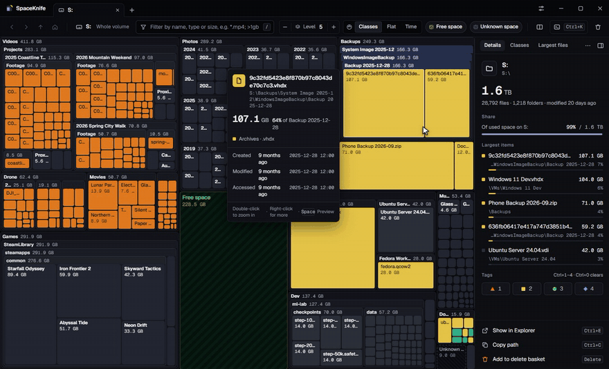
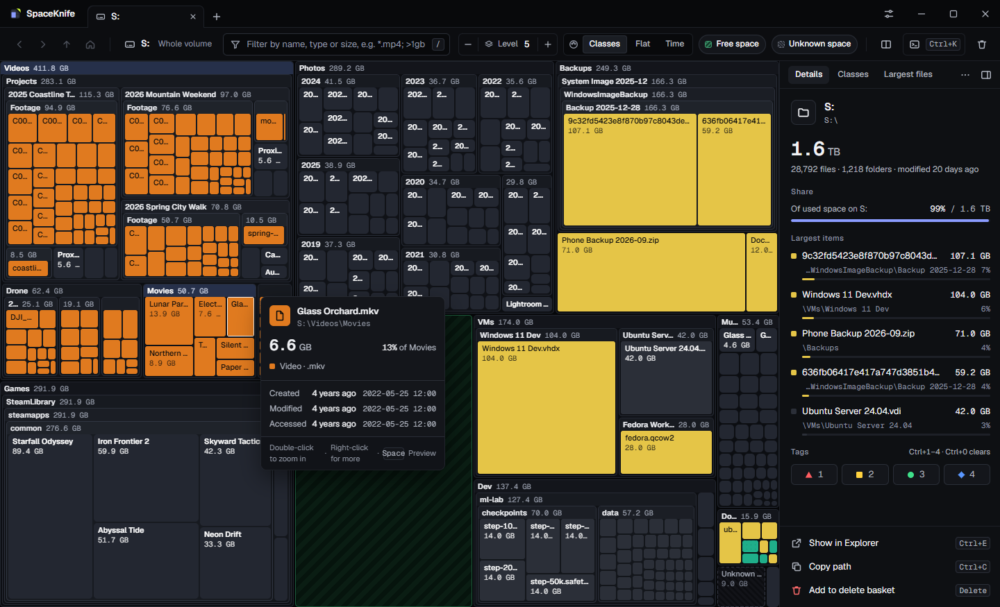
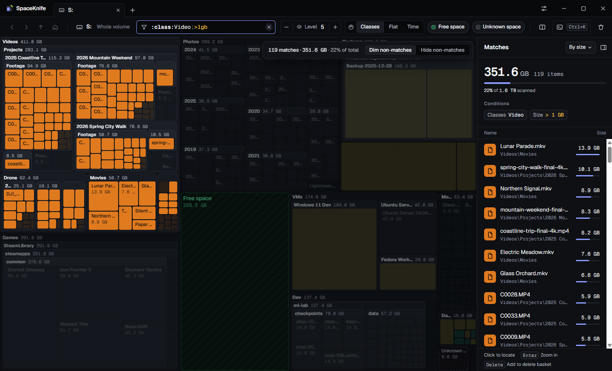
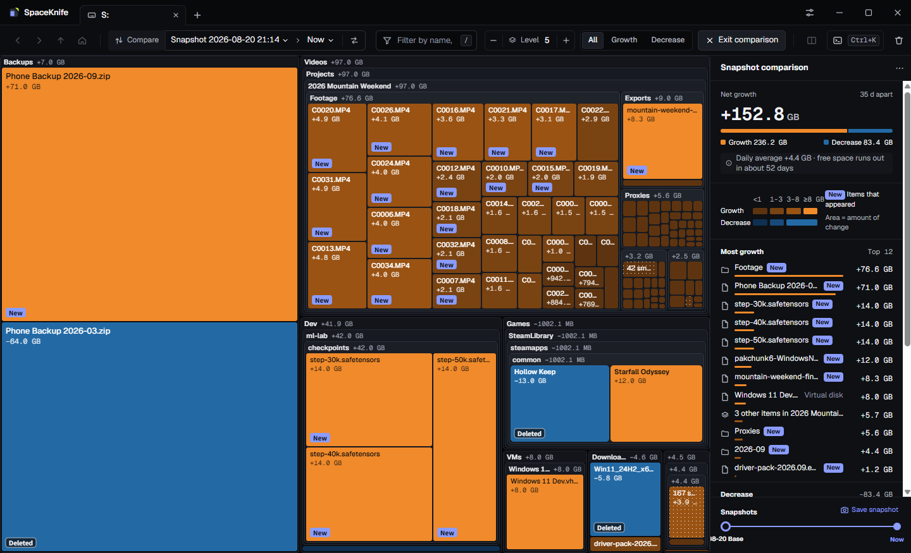
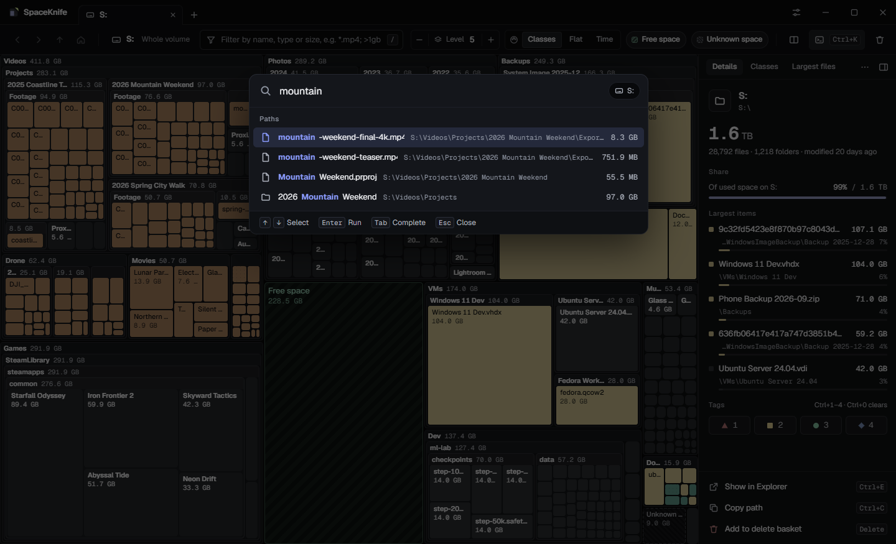

<p align="center">
  
</p>

<h1 align="center">SpaceKnife</h1>

<p align="center">
  A modern, cross-platform disk usage analyzer: a live treemap that shows what fills your drives.
</p>

<p align="center">
  <b>English</b> · <a href="README.zh-CN.md">简体中文</a> · <a href="https://spaceknife.kaltsit.dev/">Website</a> · <a href="https://github.com/DuskXi/SpaceKnife/releases">Download</a>
</p>

<p align="center">
  <a href="https://github.com/DuskXi/SpaceKnife/releases"></a>
  <a href="LICENSE"></a>
  
</p>

<p align="center">
  
</p>

SpaceKnife draws every folder and file as a block of a nested treemap, sized by the space it takes, so the space hogs stand out at a glance. It scans in parallel (or reads the NTFS Master File Table for a quick scan), can cap the disk load it causes, keeps watching for changes after the scan, and saves a snapshot after each scan so you can see what grew and what is new. Deleting goes to the recycle bin and can be undone. The interface is available in English and Simplified Chinese.

> SpaceKnife is an independent project inspired by [SpaceSniffer](http://www.uderzo.it/main_products/space_sniffer/). It is not affiliated with SpaceSniffer or its author.

## Screenshots

The screenshots show mock data: a made-up 2 TB data drive generated by [tools/demo/mock_snapshot.py](tools/demo/mock_snapshot.py), not a real disk.



**Treemap**: the area of a block is its disk usage, nested folder by folder. Hovering shows size, type and dates; the side panel shows the selection and its largest items.



**Filter**: `:class:Video;>1gb` keeps only videos larger than 1 GB lit and dims the rest; the matches are listed on the right, sortable and one click away in the treemap.



**Snapshot comparison**: against a snapshot from five weeks earlier, orange grew and blue shrank, new and deleted items are marked; the side panel shows the net growth, the biggest changes and when free space runs out at the current rate.



**Command palette** (Ctrl+K): search the whole scan by name and run any command.

## Features

- **Live treemap**: WebGL rendering that fills in while the scan runs; zoom animation, hover details, detail levels, grouping of small items, free and unknown space drawn as blocks; split view for two views side by side.
- **Fast**: parallel directory walking in a native Rust extension; on Windows a quick scan reads the NTFS Master File Table (through a read-only helper that asks for administrator rights).
- **Polite to your disk**: the scan can cap the disk load it causes (max / balanced / quiet / idle / custom) and backs off when other programs need the disk.
- **Live monitoring**: after the scan, changes keep flowing in (Windows ReadDirectoryChangesW with USN journal catch-up; Linux inotify, falling back to polling when watches run out; macOS FSEvents); changed blocks flash.
- **Filter language**: by name, type, size, dates, attributes and tags, combinable; compatible with SpaceSniffer-style filters, with extensions ([syntax](docs/filter-syntax.md), in Chinese).
- **Snapshots and comparison**: a snapshot is saved after each scan; compare any two, or a snapshot with now, showing only growth or only shrinkage.
- **Safe cleanup**: context menu and a delete basket; items go to the recycle bin by default and can be restored; system and program folders are protected.
- **Export and command line**: CSV / JSON / HTML and other templates; `spaceknife-backend scan / run / snapshot` in a terminal.
- **Two languages**: English and Simplified Chinese, following the system language, switchable at any time.

## Download

Installers are on the [Releases](https://github.com/DuskXi/SpaceKnife/releases) page (currently a pre-release):

| System | File |
|---|---|
| Windows 10+ x64 | `SpaceKnife-<version>-Setup-x64.exe` (current user or all users; not code-signed yet, so SmartScreen warns about an unknown publisher on first run: "More info › Run anyway") |
| Ubuntu 22.04+ / Debian family | `spaceknife_<version>_amd64.deb` |
| RHEL 9+ / Fedora family | `spaceknife-<version>.x86_64.rpm` |
| Other Linux x64 | `SpaceKnife-<version>-x86_64.AppImage` (needs FUSE 2, or run it with `--appimage-extract-and-run`) |
| Windows 10+ x64, portable | `SpaceKnife-<version>-win-x64-portable.zip` (no installation: unzip anywhere and run `SpaceKnife.exe`; snapshots and settings stay in the `data` folder next to it; the first launch takes a few seconds longer while Windows checks the new files) |
| Linux x64, portable | `SpaceKnife-<version>-linux-x64-portable.tar.gz` (extract anywhere and run `./spaceknife`, no FUSE needed; data stays in the `data` folder next to it) |
| macOS 14+, Apple Silicon | `SpaceKnife-<version>-mac-arm64.dmg` (preview: not notarized yet, see below) |
| macOS 14+, Intel | `SpaceKnife-<version>-mac-x64.dmg` (preview: not notarized yet, see below) |

Every release includes `SHA256SUMS.txt`.

### macOS: the first launch

The macOS build is not notarized by Apple yet, so macOS blocks it the first time. Allow it once:

1. Open the dmg and drag SpaceKnife into Applications.
2. Open SpaceKnife. macOS says it could not verify that SpaceKnife is free of malware: click **Done**.
3. Open **System Settings › Privacy & Security**, scroll down to the message that SpaceKnife was blocked, click **Open Anyway**, then **Open Anyway** again and enter your password.

From then on SpaceKnife opens normally; after installing a new version, allow it once more. On macOS 14 you can also right-click SpaceKnife in Applications and choose **Open**. If you prefer the terminal: `xattr -dr com.apple.quarantine /Applications/SpaceKnife.app`.

To scan everything without a permission prompt for each folder, give SpaceKnife **Full Disk Access** (System Settings › Privacy & Security › Full Disk Access › +), then restart it. Without it, protected places such as Mail and Messages count as unknown space. After an update, switch SpaceKnife off and on again in that list.

## Like it? Give it a star

If SpaceKnife helped you win back some disk space, please give it a ⭐ star at the top of this page. It takes one click, and it is how other people find the project: stars are a big part of how GitHub ranks and recommends repositories. It also tells us the work is worth continuing.

Other ways to help: report a bug or suggest a feature in [Issues](https://github.com/DuskXi/SpaceKnife/issues), ask and share in [Discussions](https://github.com/DuskXi/SpaceKnife/discussions), pick a [good first issue](https://github.com/DuskXi/SpaceKnife/labels/good%20first%20issue) (see [CONTRIBUTING.md](CONTRIBUTING.md)), or tell a friend whose drive is full.

## Documentation

The design documents are in Chinese:

- Plan: [docs/PLAN.md](docs/PLAN.md)
- UI specification (484 requirements): [docs/UI-SPEC.md](docs/UI-SPEC.md)
- Protocol: [docs/protocol.md](docs/protocol.md)
- Filter syntax (SKF 1): [docs/filter-syntax.md](docs/filter-syntax.md)
- Design tokens and icons: [design/README.md](design/README.md)
- Packaging and releases (Windows NSIS, Linux AppImage / deb / rpm): [docs/packaging.md](docs/packaging.md)

## Development

Requires [uv](https://docs.astral.sh/uv/); uv manages Python 3.12.

```bash
uv sync
```

```bash
uv run pytest
```

```bash
uv run spaceknife serve
```

`serve` prints one `ready` JSON line on stdout (the WebSocket address and a development token) and logs to stderr.

Scan from a terminal (parallel full scan, snapshot saved when done):

```bash
uv run spaceknife scan "C:\Program Files"
```

Add `--profile` to see where the time went: how busy the listing threads were (system calls) and how long the main thread spent folding results into the tree. `SPACEKNIFE_SCAN_THREADS` sets the number of listing threads, here and in the app, for comparisons.

```bash
uv run spaceknife snapshot list
```

The `SPACEKNIFE_HOME` environment variable puts snapshots and settings in a folder of your choice (tests and demos use it to stay away from real data).

The README screenshots are rendered off-screen from mock data: no window, no real disk (run `pnpm build` in `apps/electron` first; use a neutral empty folder for `--home`):

```bash
uv run python tools/demo/screenshots.py --home <empty folder> --out docs/images --lang both
```

The demo animation (`docs/images/demo*.gif` / `.mp4`) is recorded the same way; it needs ffmpeg:

```bash
uv run python tools/demo/screenshots.py --home <empty folder> --out docs/images --lang both --video
```

The website lives in `site/` (Astro; GitHub Actions publishes it to GitHub Pages on every push to `main`):

```bash
pnpm -C site install
```

```bash
pnpm -C site dev
```

Checks before a commit (same as CI):

```bash
uv run ruff check . && uv run ruff format --check . && uv run mypy packages/protocol/src packages/backend/src packages/client/src tools/gen_design.py && uv run python tools/gen_design.py --check && uv run pytest
```

## License

[MIT](LICENSE). The installers carry the third-party licenses in `resources/licenses/` (see [docs/packaging.md](docs/packaging.md)).

## Repository layout

| Path | Contents |
|---|---|
| `packages/protocol` | Protocol v1: pydantic message models, binary frame codec, JSON Schema |
| `packages/backend` | Backend: WebSocket server, scanning, columnar store and snapshots, filter engine, treemap layout, views, monitoring, export, file operations, command line |
| `packages/native` | Native Rust extension (PyO3): parallel directory walking, MFT parsing |
| `packages/client` | Client core shared by the Python frontends (no GUI dependencies) |
| `design/tokens`, `design/icons` | Design tokens and icon sources; `design/build` is generated |
| `apps/electron` | Electron frontend (UI v1) and installer configuration (`electron-builder.yml`) |
| `packaging` | The frozen backend (PyInstaller spec and entry point) and installer smoke tests |
| `site` | The website (Astro, GitHub Pages) |
| `tools` | Code generation and developer tools (packaging: `build_package.py`; icons: `render_app_icons.py`; screenshots: `demo/screenshots.py`) |
