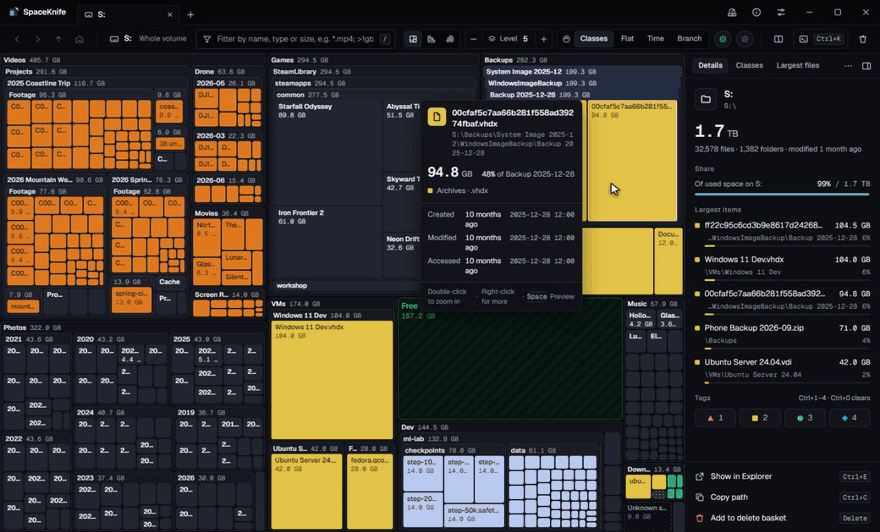
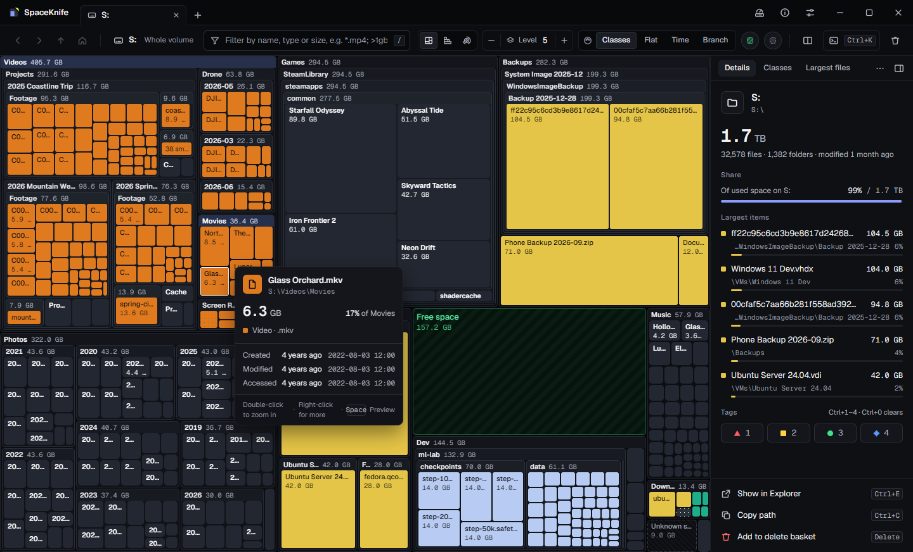
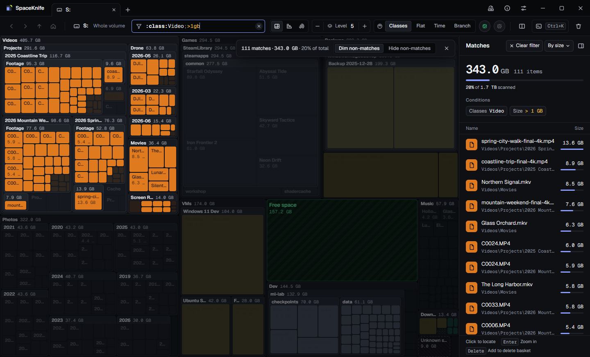
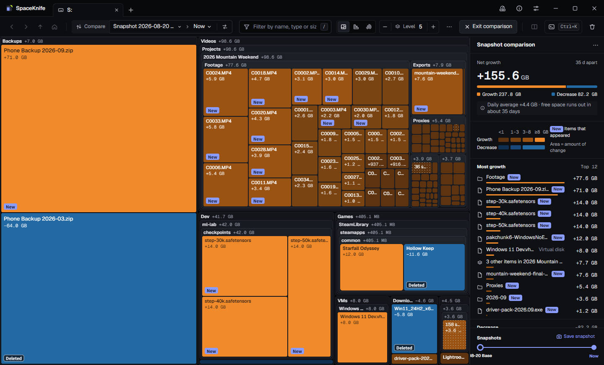
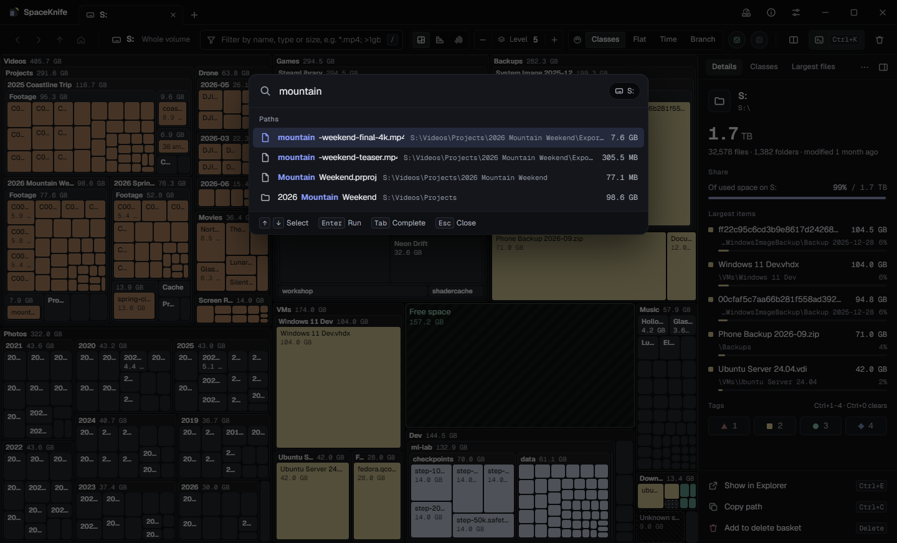

<p align="center">
  
</p>

<h1 align="center">SpaceKnife</h1>

<p align="center">
  A modern, cross-platform disk usage analyzer: a live treemap that shows what fills your drives.
</p>

<p align="center">
  <b>English</b> · <a href="README.zh-CN.md">简体中文</a> · <a href="https://spaceknife.kaltsit.dev/">Website</a> · <a href="https://github.com/DuskXi/SpaceKnife/releases">Download</a> · <a href="UNRELEASED.md">Coming next</a>
</p>

<p align="center">
  <a href="https://github.com/DuskXi/SpaceKnife/releases"></a>
  <a href="https://duskxi.github.io/spaceknife-stats/"></a>
  <a href="https://github.com/DuskXi/SpaceKnife/stargazers"></a>
  <a href="https://github.com/DuskXi/SpaceKnife/actions/workflows/ci.yml"></a>
  <a href="https://github.com/DuskXi/SpaceKnife/commits/dev"></a>
  <a href="LICENSE"></a>
</p>
<p align="center">
  
  
  <a href="https://spaceknife.kaltsit.dev/docs/"></a>
  
  <a href="https://github.com/DuskXi/SpaceKnife/issues?q=is%3Aissue%20is%3Aopen%20label%3A%22good%20first%20issue%22"></a>
</p>
<p align="center">
  
  
  
</p>

<p align="center">
  
</p>

SpaceKnife draws every folder and file as a block of a nested treemap, sized by the space it takes, so the space hogs stand out at a glance. It scans in parallel (or reads the NTFS Master File Table for a quick scan), can cap the disk load it causes, keeps watching for changes after the scan, and saves a snapshot after each scan so you can see what grew and what is new. Deleting goes to the recycle bin and can be undone. The interface is available in English and Simplified Chinese.

> SpaceKnife is an independent project inspired by [SpaceSniffer](http://www.uderzo.it/main_products/space_sniffer/). It is not affiliated with SpaceSniffer or its author.

## Screenshots

The screenshots show mock data: a made-up 2 TB data drive generated by `cargo run -p sk-store --example mock_snapshot`, not a real disk.



**Treemap**: the area of a block is its disk usage, nested folder by folder. Hovering shows size, type and dates; the side panel shows the selection and its largest items.



**Filter**: `:class:Video;>1gb` keeps only videos larger than 1 GB lit and dims the rest; the matches are listed on the right, sortable and one click away in the treemap.



**Snapshot comparison**: against a snapshot from five weeks earlier, orange grew and blue shrank, new and deleted items are marked; the side panel shows the net growth, the biggest changes and when free space runs out at the current rate.



**Command palette** (Ctrl+K): search the whole scan by name and run any command.

## Features

- **Live treemap**: WebGL rendering that fills in while the scan runs; zoom animation, hover details, detail levels, grouping of small items, free and unknown space drawn as blocks; split view for two views side by side.
- **Three visualizations**: treemap, flame graph and polar flame graph. Switch at any time, even while the scan runs; each view keeps its own.
- **Fast**: parallel directory walking in Rust; on Windows a quick scan reads the NTFS Master File Table (through a read-only helper that asks for administrator rights).
- **Polite to your disk**: the scan can cap the disk load it causes (max / balanced / quiet / idle / custom) and backs off when other programs need the disk.
- **Live monitoring**: after the scan, changes keep flowing in (Windows ReadDirectoryChangesW with USN journal catch-up; Linux inotify, falling back to polling when watches run out; macOS FSEvents); changed blocks flash.
- **Filter language**: by name, type, size, dates, attributes and tags, combinable; compatible with SpaceSniffer-style filters, with extensions ([syntax](docs/filter-syntax.md), in Chinese).
- **Snapshots and comparison**: a snapshot is saved after each scan; compare any two, or a snapshot with now, showing only growth or only shrinkage.
- **Safe cleanup**: context menu and a delete basket; items go to the recycle bin by default and can be restored; system and program folders are protected.
- **Export and command line**: CSV / JSON / HTML and other templates; `spaceknife-cli scan / run / snapshot` in a terminal, and `spaceknife-cli headless` to use SpaceKnife from a browser.
- **Two languages**: English and Simplified Chinese, following the system language, switchable at any time.

## Download

Installers are on the [Releases](https://github.com/DuskXi/SpaceKnife/releases) page (currently a pre-release):

| System | File |
|---|---|
| Windows 10+ x64 | `SpaceKnife-<version>-Setup-x64.exe` (for the current user or all users; installs the WebView2 Runtime if it is missing; not code-signed yet, so SmartScreen warns about an unknown publisher on first run: "More info › Run anyway") |
| Ubuntu 22.04+ / Debian family | `spaceknife_<version>_amd64.deb` |
| RHEL 9+ / Fedora family | `spaceknife-<version>.x86_64.rpm` |
| Other Linux x64 | `SpaceKnife-<version>-x86_64.AppImage` (needs FUSE 2, or run it with `--appimage-extract-and-run`) |
| Windows 10+ x64, portable | `SpaceKnife-<version>-win-x64-portable.zip` (no installation: unzip anywhere and run `SpaceKnife.exe`; snapshots and settings stay in the `data` folder next to it; needs the WebView2 Runtime, which Windows 11 has; the first launch takes a few seconds longer while Windows checks the new files) |
| Linux x64 / arm64, portable, small | `SpaceKnife-<version>-linux-<x64 or arm64>-tauri.tar.gz` (extract anywhere and run `./spaceknife`, no FUSE needed; data stays in the `data` folder next to it; uses the system's WebKitGTK 4.1, so not for RHEL 9) |
| Linux x64 / arm64, portable, any distribution | `SpaceKnife-<version>-linux-<x64 or arm64>-portable.tar.gz` (the same, with its own engine (Electron), so it runs on RHEL 9 too; the name of 0.3.4's Linux portable) |
| Windows 11 on ARM, portable | `SpaceKnife-<version>-win-arm64-portable.zip` (the Windows portable, built for arm64; the installers are x64 only) |
| macOS 14+, Apple Silicon | `SpaceKnife-<version>-mac-arm64.dmg` (preview: not notarized yet, see below) |
| macOS 14+, Intel | `SpaceKnife-<version>-mac-x64.dmg` (preview: not notarized yet, see below) |
| macOS 14+, portable | `SpaceKnife-<version>-mac-<arm64 or x64>-portable.zip` (unzip anywhere and open `SpaceKnife.app`; data stays in the `data` folder next to it; allow it once as below) |

Every release includes `SHA256SUMS.txt` and the `SHA256SUMS-portable-…`, `SHA256SUMS-tauri-linux-…` and `SHA256SUMS-mac-…` lists. Each package also carries the command-line program `spaceknife-cli` next to the app. The window is the same everywhere: most downloads draw it with the system's web view (WebView2, WebKit, WebKitGTK) and are small; the rpm, the AppImage and the portable `…-linux-<arch>-portable.tar.gz` bring their own (Electron), because RHEL 9 has no WebKitGTK 4.1.

> **Updating from 0.3.4:** the release files keep 0.3.4's names, so 0.3.4's update check finds 0.3.5 and installs it like any update: **Seamless update** for the Windows installer (it installs 0.3.5 where 0.3.4 was, with the same shortcuts and one entry in the app list), the portable copies and the AppImage; the disk image or the package for the dmg, deb and rpm. Settings, file classes, tags and snapshots stay, and the snapshots 0.3.x saved still open. What changes for each kind of install: [Upgrading from 0.3.4](https://spaceknife.kaltsit.dev/docs/install/#upgrading-from-034).

From 0.3.1 on, SpaceKnife checks this repository's releases at most once a day (it sends nothing about you or your files). A small update shows a badge at the top right; a bigger one also shows a summary. The new version is downloaded in the background and checked against the release's checksums. From 0.3.3 on, the update card offers two ways to install it: **Seamless update** (Windows installer, portable copies, AppImage) puts it in place and opens SpaceKnife again, the classic way opens the installer, the disk image or the package (or shows the file, to replace it yourself); **Skip 0.4.x** silences a whole series. SpaceKnife never installs an update by itself: nothing starts until you click. Turn the check off in Settings › About & updates.

### macOS: the first launch

The macOS build is not notarized by Apple yet, so macOS blocks it the first time. Allow it once:

1. Open the dmg and drag SpaceKnife into Applications.
2. Open SpaceKnife. macOS says it could not verify that SpaceKnife is free of malware: click **Done**.
3. Open **System Settings › Privacy & Security**, scroll down to the message that SpaceKnife was blocked, click **Open Anyway**, then **Open Anyway** again and enter your password.

From then on SpaceKnife opens normally; after installing a new version, allow it once more. On macOS 14 you can also right-click SpaceKnife in Applications and choose **Open**. If you prefer the terminal: `xattr -dr com.apple.quarantine /Applications/SpaceKnife.app`.

To scan everything without a permission prompt for each folder, give SpaceKnife **Full Disk Access** (System Settings › Privacy & Security › Full Disk Access › +), then restart it. Without it, protected places such as Mail and Messages count as unknown space. After an update, switch SpaceKnife off and on again in that list.

## Like it? Give it a star

If SpaceKnife helped you win back some disk space, please give it a ⭐ star at the top of this page. It takes one click, and it is how other people find the project: stars are a big part of how GitHub ranks and recommends repositories. It also tells us the work is worth continuing.

Other ways to help: report a bug or suggest a feature in [Issues](https://github.com/DuskXi/SpaceKnife/issues), ask and share in [Discussions](https://github.com/DuskXi/SpaceKnife/discussions), pick a [good first issue](https://github.com/DuskXi/SpaceKnife/labels/good%20first%20issue) (see [CONTRIBUTING.md](CONTRIBUTING.md)), or tell a friend whose drive is full.

## Documentation

The design documents are in Chinese:

- Plan: [docs/PLAN.md](docs/PLAN.md)
- UI specification (512 requirements): [docs/UI-SPEC.md](docs/UI-SPEC.md)
- Protocol: [docs/protocol.md](docs/protocol.md)
- Visualizations (engines, wire layouts, renderer components): [docs/visuals.md](docs/visuals.md)
- Filter syntax (SKF 1): [docs/filter-syntax.md](docs/filter-syntax.md)
- Design tokens and icons: [design/README.md](design/README.md)
- Packaging and releases (installers, portable copies, the Tauri and Electron shells, updates): [docs/packaging.md](docs/packaging.md)

## Development

Requires [rustup](https://rustup.rs/) (the first time cargo runs in the repository it installs the Rust version `rust-toolchain.toml` pins, edition 2024; CI uses the same one), Node.js 24 and pnpm 10. On Linux, Tauri also needs the system WebView and a few libraries:

```bash
sudo apt install libwebkit2gtk-4.1-dev libgtk-3-dev libayatana-appindicator3-dev librsvg2-dev libssl-dev patchelf
```

Build and test the Rust workspace (`cargo build` builds the crates in `crates/`; `--workspace` also takes in the Tauri app in `apps/desktop/src-tauri`):

```bash
cargo build
```

```bash
cargo test --workspace
```

Run the app window (the backend runs inside the app process):

```bash
cd apps/desktop && pnpm install && pnpm tauri dev
```

The same interface also runs in the Electron shell (`apps/electron-shell`: the rpm, the AppImage and the Linux portable that brings its own engine use it, as RHEL 9 has no WebKitGTK 4.1). It starts `spaceknife-cli serve` as its backend and loads the built interface:

```bash
cargo build -p sk-server --bin spaceknife-cli && pnpm -C apps/desktop generate && pnpm -C apps/electron-shell install && pnpm -C apps/electron-shell dev
```

Build the Tauri bundles (`pnpm bundle`: NSIS on Windows, AppImage / deb / rpm on Linux, app / dmg on macOS) and the portable archives (`pnpm bundle:portable`, after `pnpm bundle`), in `apps/desktop`; the Electron shell's packages are `pnpm -C apps/electron-shell package` (which of them a release publishes: [docs/packaging.md](docs/packaging.md)):

```bash
pnpm bundle && pnpm bundle:portable
```

The command-line program is `spaceknife-cli`. `serve` prints one `ready` JSON line on stdout (the WebSocket address and a development token) and logs to stderr:

```bash
cargo run -p sk-server --bin spaceknife-cli -- serve
```

Scan from a terminal (parallel full scan, snapshot saved when done):

```bash
cargo run --release -p sk-server --bin spaceknife-cli -- scan "C:\Program Files"
```

Add `--profile` to see where the time went: how busy the listing threads were (system calls) and how long the main thread spent folding results into the tree. `SPACEKNIFE_SCAN_THREADS` sets the number of listing threads, here and in the app, for comparisons.

```bash
cargo run -p sk-server --bin spaceknife-cli -- snapshot list
```

`spaceknife-cli headless [--listen <address>]` serves the interface to a browser instead of opening a window.

The `SPACEKNIFE_HOME` environment variable puts snapshots and settings in a folder of your choice (tests and demos use it to stay away from real data).

The README screenshots are rendered off-screen from mock data: no window, no real disk (use a neutral empty folder for `--home`):

```bash
node tools/demo/screenshots.mjs --home <empty folder> --out docs/images --lang both
```

The demo animation (`docs/images/demo*.gif` / `.mp4`) is recorded the same way; it needs ffmpeg:

```bash
node tools/demo/screenshots.mjs --home <empty folder> --out docs/images --lang both --video
```

The website lives in `site/` (Astro; GitHub Actions publishes it to GitHub Pages on every push to `main`):

```bash
pnpm -C site install
```

```bash
pnpm -C site dev
```

Checks before a commit (same as CI):

```bash
cargo fmt --check && cargo clippy --workspace --all-targets -- -D warnings && cargo test --workspace
```

```bash
node tools/gen_design.mjs --check && node --test "tools/tests/*.test.mjs"
```

```bash
cd apps/desktop && pnpm typecheck && pnpm test
```

```bash
cd apps/electron-shell && pnpm typecheck && pnpm test
```

`cargo test --workspace` also replays the parity gate (`tests/parity`): the Rust backend's answers over the protocol, compared with what 0.3.4's Python backend answered to the same scenarios. More in [CONTRIBUTING.md](CONTRIBUTING.md).

## License

[MIT](LICENSE). The installers carry the third-party licenses in a `licenses` folder with the app (`resources/licenses` in the Electron builds; see [docs/packaging.md](docs/packaging.md)).

## Repository layout

| Path | Contents |
|---|---|
| `crates/sk-protocol` | Protocol v1: message types, binary frame codec, JSON Schema and the generated TypeScript (`cargo run -p sk-protocol --bin gen-ts`) |
| `crates/sk-native` | Native scanning: parallel directory walking, MFT parsing |
| `crates/sk-store` | Columnar file tree store and snapshots |
| `crates/sk-core` | Scanning, filter engine, layouts, views, monitoring, export, file operations, settings, updates |
| `crates/sk-server` | WebSocket server and the command line `spaceknife-cli` (scan, run, snapshot, serve, headless) |
| `design/tokens`, `design/icons` | Design tokens and icon sources; `design/build` is generated |
| `apps/desktop` | The desktop app: Tauri 2 (`src-tauri`) with a Nuxt 4 / Vue 3 interface (`app`); bundles and portable archives |
| `apps/electron-shell` | The Electron shell for where Tauri can't run (main process and preload; the interface is `apps/desktop`'s) |
| `packaging` | Tests of the built packages (smoke, headless, updates, also from 0.3.4) and the Windows console launcher `SpaceKnife.com` |
| `tests/parity` | The parity gate: the same protocol scenarios against 0.3.4's backend and the Rust one |
| `site` | The website (Astro, GitHub Pages) |
| `tools` | Code generation and developer tools (design tokens: `gen_design.mjs`; releases: `release.mjs`; screenshots: `demo/screenshots.mjs`) |
