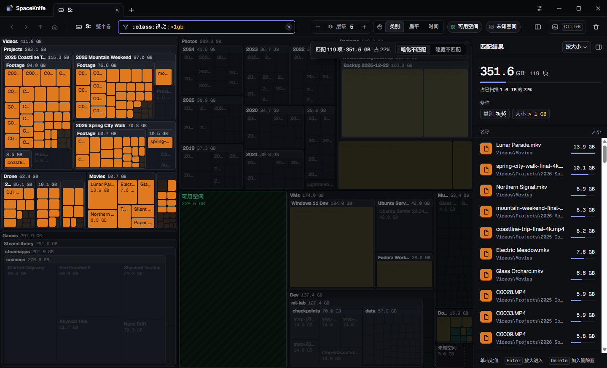
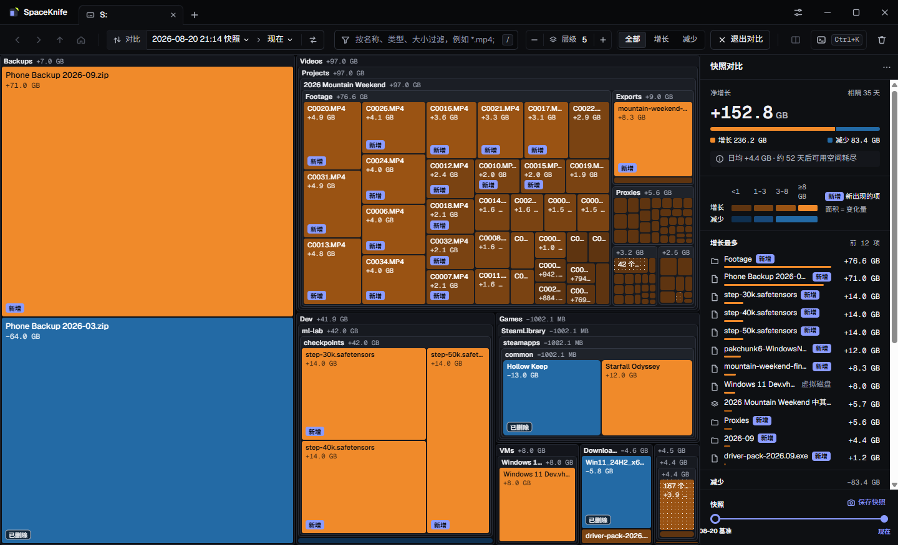
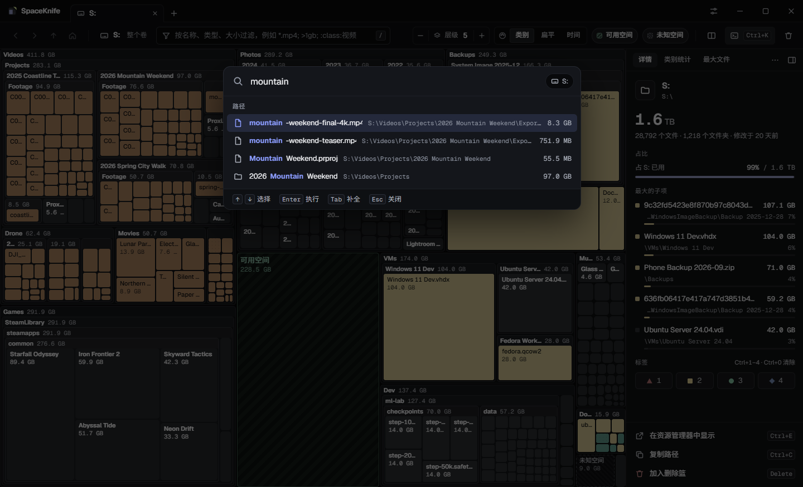

# SpaceKnife

现代化的跨平台硬盘占用分析工具：用嵌套树图实时展示磁盘被什么占满。支持 NTFS MFT 快速扫描、可限制磁盘负载的并发扫描、文件变化实时监控、过滤语言、快照对比和可撤销的删除篮，界面有简体中文和英文。目标平台 Windows 10+、Linux（RHEL 9+ / Ubuntu 22.04+），之后是 macOS 14+。

> SpaceKnife 受 [SpaceSniffer](http://www.uderzo.it/main_products/space_sniffer/) 启发，是一个独立开发的新项目，与 SpaceSniffer 及其作者没有任何关联。
>
> SpaceKnife is an independent project inspired by SpaceSniffer. It is not affiliated with SpaceSniffer or its author.

## 截图

截图里是模拟数据：一个虚构的 2 TB 数据盘（[tools/demo/mock_snapshot.py](tools/demo/mock_snapshot.py) 生成），不是真实的磁盘。


**树图**：块的面积就是占用，嵌套显示每一层文件夹；悬停显示大小、类型和时间，右侧是选中项的详情和最大的子项。



**过滤**：`:class:视频;>1gb` 只亮出 1 GB 以上的视频，其余变暗；右侧列出匹配结果，可按大小排序、定位。



**快照对比**：和五周前的快照相比，橙色是增长、蓝色是减少，新增和已删除的项都有标记；右侧是净增长、增长最多的项和按当前速度估算的可用空间耗尽时间。



**命令面板**（Ctrl+K）：按名称搜索整个扫描结果（支持拼音首字母），也可以直接执行命令。

## 下载

安装包在 [Releases](https://github.com/DuskXi/SpaceKnife/releases)（目前是预发布版）：

| 系统 | 文件 |
|---|---|
| Windows 10+ x64 | `SpaceKnife-<版本>-Setup-x64.exe`（可选仅当前用户或所有用户；还没有代码签名，第一次运行时 SmartScreen 会提示「未知发布者」，点「更多信息 › 仍要运行」） |
| Ubuntu 22.04+ / Debian 系 | `spaceknife_<版本>_amd64.deb` |
| RHEL 9+ / Fedora 系 | `spaceknife-<版本>.x86_64.rpm` |
| 其他 Linux x64 | `SpaceKnife-<版本>-x86_64.AppImage`（需要 FUSE 2，或加 `--appimage-extract-and-run` 运行） |

界面有简体中文和英文，默认跟随系统语言。macOS 版暂不提供。

- 计划：[docs/PLAN.md](docs/PLAN.md)
- UI 需求规格（484 条）：[docs/UI-SPEC.md](docs/UI-SPEC.md)
- 协议：[docs/protocol.md](docs/protocol.md)
- 过滤语法（SKF 1）：[docs/filter-syntax.md](docs/filter-syntax.md)
- 设计 token 与图标：[design/README.md](design/README.md)
- 打包与发布（Windows NSIS、Linux AppImage / deb / rpm）：[docs/packaging.md](docs/packaging.md)

## 开发环境

需要 [uv](https://docs.astral.sh/uv/)，Python 3.12 由 uv 管理。

```bash
uv sync
```

```bash
uv run pytest
```

```bash
uv run spaceknife serve
```

`serve` 启动后在 stdout 打印一行 `ready` JSON（含 WebSocket 地址和开发用 token），日志输出到 stderr。

在终端里直接扫描（并行硬扫描，完成后自动保存快照）：

```bash
uv run spaceknife scan "C:\Program Files"
```

```bash
uv run spaceknife snapshot list
```

环境变量 `SPACEKNIFE_HOME` 可以把快照等数据放到指定目录（测试和体验环境用它与真实数据隔离）。

README 的截图用模拟数据离屏生成，不显示窗口、不读真实磁盘（先在 `apps/electron` 里 `pnpm build`；`--home` 用一个中性的空目录）：

```bash
uv run python tools/demo/screenshots.py --home <空目录> --out docs/images
```

M2 体验台（浏览器里的树图、导航、过滤和标签，直接走协议 v1）：

```bash
uv run python tools/demo/m2_demo.py
```

性能基准（布局、过滤、视图渲染，合成大树）：

```bash
uv run python tools/bench_m2.py --nodes 3000000
```

提交前的检查（与 CI 一致）：

```bash
uv run ruff check . && uv run ruff format --check . && uv run mypy packages/protocol/src packages/backend/src packages/client/src tools/gen_design.py && uv run python tools/gen_design.py --check && uv run pytest
```

## 许可证

[MIT](LICENSE)。安装包里附带的第三方许可证见 `resources/licenses/`（[docs/packaging.md](docs/packaging.md)）。

## 仓库结构

| 路径 | 内容 |
|---|---|
| `packages/protocol` | 协议 v1：pydantic 消息模型、二进制帧编解码、JSON Schema |
| `packages/backend` | 后端：WebSocket 服务、扫描、列式存储与快照、过滤引擎、树图布局、视图、命令行（之后加入监控、导出、文件操作） |
| `packages/client` | Python 前端共享的客户端核心（不依赖任何 GUI 库） |
| `design/tokens`、`design/icons` | 设计 token 与图标源文件；`design/build` 是生成物 |
| `apps/electron` | Electron 前端（UI v1）与安装包配置（`electron-builder.yml`） |
| `packaging` | 冻结后端（PyInstaller spec 与入口）和安装包的冒烟测试 |
| `tools` | 代码生成与开发工具（打包：`build_package.py`；图标：`render_app_icons.py`） |
