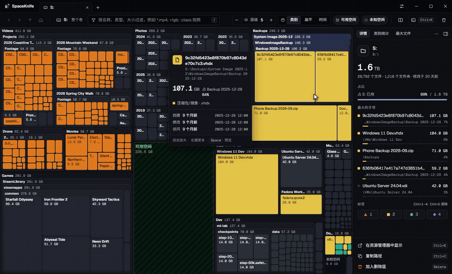

<p align="center">
  
</p>

<h1 align="center">SpaceKnife</h1>

<p align="center">
  现代化的跨平台硬盘占用分析工具：用实时树图看清磁盘被什么占满。
</p>

<p align="center">
  <a href="README.md">English</a> · <b>简体中文</b> · <a href="https://spaceknife.kaltsit.dev/zh/">官网</a> · <a href="https://github.com/DuskXi/SpaceKnife/releases">下载</a> · <a href="UNRELEASED.md#简体中文">即将发布</a>
</p>

<p align="center">
  <a href="https://github.com/DuskXi/SpaceKnife/releases"></a>
  <a href="https://duskxi.github.io/spaceknife-stats/"></a>
  <a href="https://github.com/DuskXi/SpaceKnife/stargazers"></a>
  <a href="https://github.com/DuskXi/SpaceKnife/actions/workflows/ci.yml"></a>
  <a href="https://github.com/DuskXi/SpaceKnife/commits/dev"></a>
  <a href="LICENSE"></a>
</p>
<p align="center">
  
  
  <a href="https://spaceknife.kaltsit.dev/zh/docs/"></a>
  
  <a href="https://github.com/DuskXi/SpaceKnife/issues?q=is%3Aissue%20is%3Aopen%20label%3A%22good%20first%20issue%22"></a>
</p>
<p align="center">
  
  
  
  <a href="https://github.com/astral-sh/uv"></a>
  <a href="https://github.com/astral-sh/ruff"></a>
  
</p>

<p align="center">
  
</p>

SpaceKnife 用嵌套树图实时展示每个文件夹、每个文件占了多少空间：块越大，占用越多，一眼就能找到占地方的东西。它支持 NTFS MFT 快速扫描和可限制磁盘负载的并发扫描，扫描后自动保存快照，可以看出两次之间什么变大了、什么是新出现的；删除默认进回收站，可以撤销。界面有简体中文和英文。

> SpaceKnife 受 [SpaceSniffer](http://www.uderzo.it/main_products/space_sniffer/) 启发，是一个独立开发的新项目，与 SpaceSniffer 及其作者没有任何关联。

## 截图

截图里是模拟数据：一个虚构的 2 TB 数据盘（[tools/demo/mock_snapshot.py](tools/demo/mock_snapshot.py) 生成），不是真实的磁盘。


**树图**：块的面积就是占用，嵌套显示每一层文件夹；悬停显示大小、类型和时间，右侧是选中项的详情和最大的子项。


**过滤**：`:class:视频;>1gb` 只亮出 1 GB 以上的视频，其余变暗；右侧列出匹配结果，可按大小排序、定位。


**快照对比**：和五周前的快照相比，橙色是增长、蓝色是减少，新增和已删除的项都有标记；右侧是净增长、增长最多的项和按当前速度估算的可用空间耗尽时间。


**命令面板**（Ctrl+K）：按名称搜索整个扫描结果（支持拼音首字母），也可以直接执行命令。

## 功能

- **实时树图**：WebGL 渲染，边扫边画；缩放动画、悬停详情、细节层级、小项聚合，可用空间与未知空间也画出来；可分屏开两个视图。
- **三种可视化**：树图、火焰图、火焰-极坐标图，扫描中也能随时切换，每个视图各用各的。
- **快**：Rust 原生扩展做并行目录遍历；Windows 上可读取 NTFS 主文件表（MFT）快速扫描（通过一个只读的提权助手，需要管理员确认）。
- **不拖慢电脑**：扫描可以限制自己造成的磁盘负载（极速 / 均衡 / 安静 / 空闲 / 自定义），别的程序在用磁盘时自动让路。
- **实时监控**：扫描后继续跟踪文件变化（Windows ReadDirectoryChangesW + USN 日志补偿；Linux inotify，额度不够时改为轮询；macOS FSEvents），变化的块会闪烁。
- **过滤语言**：按名称、类型、大小、时间、属性、标签过滤，可以组合；与 SpaceSniffer 的过滤写法兼容并做了扩展（[语法](docs/filter-syntax.md)）。
- **快照与对比**：扫描后自动保存快照；任意两次对比，或与「现在」对比，只看增长或减少。
- **安全的清理**：右键菜单与删除篮，默认移到回收站，可以撤销；系统和程序目录受保护。
- **导出与命令行**：CSV / JSON / HTML 等模板导出；`spaceknife-backend scan / run / snapshot` 可在终端里用。
- **双语界面**：简体中文与英文，默认跟随系统语言，设置里即时切换。

## 下载

安装包在 [Releases](https://github.com/DuskXi/SpaceKnife/releases)（目前是预发布版）：

| 系统 | 文件 |
|---|---|
| Windows 10+ x64 | `SpaceKnife-<版本>-Setup-x64.exe`（可选仅当前用户或所有用户；还没有代码签名，第一次运行时 SmartScreen 会提示「未知发布者」，点「更多信息 › 仍要运行」） |
| Ubuntu 22.04+ / Debian 系 | `spaceknife_<版本>_amd64.deb` |
| RHEL 9+ / Fedora 系 | `spaceknife-<版本>.x86_64.rpm` |
| 其他 Linux x64 | `SpaceKnife-<版本>-x86_64.AppImage`（需要 FUSE 2，或加 `--appimage-extract-and-run` 运行） |
| Windows 10+ x64 便携版 | `SpaceKnife-<版本>-win-x64-portable.zip`（免安装：解压到任意位置，运行 `SpaceKnife.exe`；快照和设置都存在旁边的 `data` 文件夹里；解压后第一次启动会慢几秒，Windows 要先检查这些新文件） |
| Linux x64 便携版 | `SpaceKnife-<版本>-linux-x64-portable.tar.gz`（解压后运行 `./spaceknife`，不需要 FUSE；数据存在旁边的 `data` 文件夹里） |
| macOS 14+，Apple Silicon | `SpaceKnife-<版本>-mac-arm64.dmg`（预览版：还没经过苹果公证，见下文） |
| macOS 14+，Intel | `SpaceKnife-<版本>-mac-x64.dmg`（预览版：还没经过苹果公证，见下文） |

每个版本都附带 `SHA256SUMS.txt`。

从 0.3.1 起，SpaceKnife 每天最多检查一次本仓库的发布（不发送任何关于你或你的文件的信息）。小版本只在右上角显示徽章；版本跨度更大时还会显示更新概要和「一键下载」，下载的文件按发布里的校验和核对。可以在「设置 › 常规 › 更新」里关掉。

### macOS：第一次打开

macOS 版还没有经过苹果公证，第一次打开会被系统拦下，需要手动放行一次：

1. 打开 dmg，把 SpaceKnife 拖进「应用程序」。
2. 打开 SpaceKnife，系统提示无法验证它是否包含恶意软件，点「完成」。
3. 打开「系统设置 › 隐私与安全性」，往下找到 SpaceKnife 已被阻止的提示，点「仍要打开」，再点一次「仍要打开」并输入密码。

之后就能正常打开；安装新版本后需要再放行一次。macOS 14 上也可以在「应用程序」里右键 SpaceKnife 选「打开」。习惯用终端的话：`xattr -dr com.apple.quarantine /Applications/SpaceKnife.app`。

想不被逐个文件夹的授权提示打断、扫到所有位置，给 SpaceKnife 开「完全磁盘访问权限」（系统设置 › 隐私与安全性 › 完全磁盘访问权限 › +），然后重新打开它。不开的话，邮件、信息等受保护的位置计入未知空间。更新版本后，在这个列表里把 SpaceKnife 关掉再打开一次。

## 觉得好用？点个 Star

如果 SpaceKnife 帮你找回了磁盘空间，欢迎点一下页面顶部的 ⭐ Star。只要点一下，却是别人发现这个项目的主要途径：Star 数是 GitHub 排名和推荐仓库的重要依据。它也让我们知道这件事值得继续做下去。

也可以这样参与：在 [Issues](https://github.com/DuskXi/SpaceKnife/issues) 里报告问题、提建议，在 [Discussions](https://github.com/DuskXi/SpaceKnife/discussions) 里提问和交流，认领一个[新手任务](https://github.com/DuskXi/SpaceKnife/labels/good%20first%20issue)（见 [CONTRIBUTING.md](CONTRIBUTING.md)），或者推荐给硬盘快满了的朋友。

## 文档

- 计划：[docs/PLAN.md](docs/PLAN.md)
- UI 需求规格（512 条）：[docs/UI-SPEC.md](docs/UI-SPEC.md)
- 协议：[docs/protocol.md](docs/protocol.md)
- 可视化（引擎、线上布局、前端组件）：[docs/visuals.md](docs/visuals.md)
- 过滤语法（SKF 1）：[docs/filter-syntax.md](docs/filter-syntax.md)
- 设计 token 与图标：[design/README.md](design/README.md)
- 打包与发布（Windows NSIS、Linux AppImage / deb / rpm）：[docs/packaging.md](docs/packaging.md)

## 开发环境

需要 [uv](https://docs.astral.sh/uv/)，Python 3.12 由 uv 管理。

```bash
uv sync
```

```bash
uv run pytest
```

```bash
uv run spaceknife serve
```

`serve` 启动后在 stdout 打印一行 `ready` JSON（含 WebSocket 地址和开发用 token），日志输出到 stderr。

在终端里直接扫描（并行硬扫描，完成后自动保存快照）：

```bash
uv run spaceknife scan "C:\Program Files"
```

加 `--profile` 可以看耗时分解：列目录线程有多忙（系统调用），主线程把结果合并进树用了多久。环境变量 `SPACEKNIFE_SCAN_THREADS` 设定列目录线程数（命令行和应用都认），用来对比。

```bash
uv run spaceknife snapshot list
```

环境变量 `SPACEKNIFE_HOME` 可以把快照等数据放到指定目录（测试和体验环境用它与真实数据隔离）。

README 的截图用模拟数据离屏生成，不显示窗口、不读真实磁盘（先在 `apps/electron` 里 `pnpm build`；`--home` 用一个中性的空目录）：

```bash
uv run python tools/demo/screenshots.py --home <空目录> --out docs/images --lang both
```

演示动画（`docs/images/demo*.gif` / `.mp4`）用同样的方式录制，需要 ffmpeg：

```bash
uv run python tools/demo/screenshots.py --home <空目录> --out docs/images --lang both --video
```

官网在 `site/`（Astro，推送到 `main` 后由 GitHub Actions 发布到 GitHub Pages）：

```bash
pnpm -C site install
```

```bash
pnpm -C site dev
```

提交前的检查（与 CI 一致）：

```bash
uv run ruff check . && uv run ruff format --check . && uv run mypy packages/protocol/src packages/backend/src packages/client/src tools/gen_design.py && uv run python tools/gen_design.py --check && uv run pytest
```

## 许可证

[MIT](LICENSE)。安装包里附带的第三方许可证见 `resources/licenses/`（[docs/packaging.md](docs/packaging.md)）。

## 仓库结构

| 路径 | 内容 |
|---|---|
| `packages/protocol` | 协议 v1：pydantic 消息模型、二进制帧编解码、JSON Schema |
| `packages/backend` | 后端：WebSocket 服务、扫描、列式存储与快照、过滤引擎、树图布局、视图、监控、导出、文件操作、命令行 |
| `packages/native` | Rust 原生扩展（PyO3）：并行目录遍历、MFT 解析 |
| `packages/client` | Python 前端共享的客户端核心（不依赖任何 GUI 库） |
| `design/tokens`、`design/icons` | 设计 token 与图标源文件；`design/build` 是生成物 |
| `apps/electron` | Electron 前端（UI v1）与安装包配置（`electron-builder.yml`） |
| `packaging` | 冻结后端（PyInstaller spec 与入口）和安装包的冒烟测试 |
| `site` | 官网（Astro，GitHub Pages） |
| `tools` | 代码生成与开发工具（打包：`build_package.py`；图标：`render_app_icons.py`；截图：`demo/screenshots.py`） |
