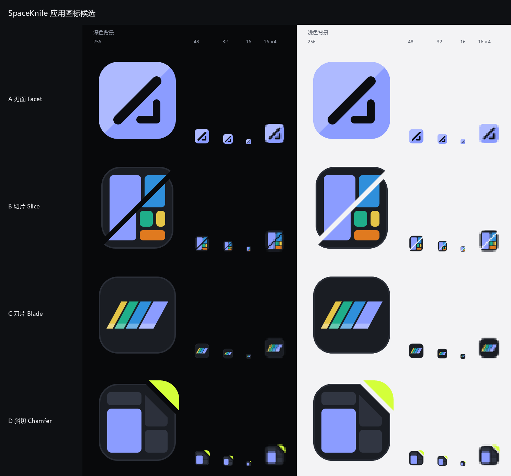

# 应用图标候选

窗口、任务栏和安装包现在还用着 Electron 默认图标。这里放四版候选，**选定一版之后**再按 TODO.md M8 导出 Windows `.ico`、Linux hicolor PNG 全套与 `.desktop`、NSIS 图标，并让标题栏标识（`design/build/icons/logo.svg`）跟着统一。这一步不碰打包配置和界面代码。



| 文件 | 内容 |
|---|---|
| `candidates/<名字>.svg` | 1024×1024 母版 |
| `candidates/<名字>-16/32/48/256.png` | 直接从母版渲染的预览，不做小尺寸专用版 |
| `candidates/overview.png` | 全部候选在深色（`color.bg.window` #08090B）和浅色（#F3F3F5）背景上，256 / 48 / 32 / 16 px 原尺寸，加 16 px 放大 4 倍（最近邻，看清像素） |

## 共同约定

- 画布 1024，**64 单位 = 16 px 下的 1 像素**。底板统一是 `x = y = 64`、边长 896、圆角 224 的圆角方块：16 px 下四周各留 1 px，圆角 3.5 px，和标题栏标识一致。底板和 A 的笔画压在 64 的整数倍上；B、D 的树图块和 C 的刀片按 1024 画布的比例画，16 px 下不追求整像素（块与块之间的间隙本来就不到 1 px）。
- 只用纯色平涂，不用渐变、阴影、高光；「立体感」只靠同色系的两个色阶（A 的刃面、C 的磨刃面）。
- 颜色全部取自 `design/build/tokens.ts`，下面每版都列了令牌名。石墨底板统一用 `color.bg.hover` #1A1D23（比窗口底色 #08090B 亮一档，深色任务栏上不至于整块消失），外加 16 单位的 `color.line.strong` #2A2E37 描边；描边在 48 px 以上才看得出，16 px 下等于没有。
- 16 px 的判断标准：在任务栏 / 文件管理器里一眼能和别的应用区分开，不要求细节还在。

## A 刃面 Facet — `facet.svg`

把现在标题栏里的 16 px 标识原样放大 64 倍：强调色圆角方块 + 一道斜切 + 右下角的直角标（「量出来的那块空间」）。底板沿斜切方向分成两个刃面，左上半边是强调色向白色混 30 % 的浅色阶，像刀刃的磨面。

- 取色：底板 `color.accent.default` #8B9CFF；浅刃面 #AEBAFF（#8B9CFF 向白混 30 %）；斜切与直角标 `color.text.onAccent` #0B0C10。
- 16 px：斜切 1.75 px、直角标 1.4 px，和标题栏标识落在同一组像素上，所以**任务栏图标和窗口标题栏里的标识是同一个东西**。两个刃面只差 30 % 明度，16 px 下基本看不出，这是给大尺寸的附赠细节。
- 取舍：四版里最简洁、深浅背景上都最醒目（唯一的亮色底板）；代价是「空间 / 树图」只靠一个直角标暗示，不如 B、D 直白。和标题栏标识统一的成本最低。

## B 切片 Slice — `slice.svg`

石墨底板上一张五块的树图（最大一块用强调色，其余用树图类别色），被一刀沿对角线切开，两半沿刀口各错开 28 单位。最直接地对应「树图被一刀切开」。

- 取色：底板 `color.bg.hover` #1A1D23 + 描边 `color.line.strong` #2A2E37；色块 `color.accent.default` #8B9CFF、`treemap.class.image` #2F8FDB、`treemap.class.exec` #1FAE8A、`treemap.class.archive` #E5C547、`treemap.class.video` #E07A1F。刀口是镂空的（宽 56 单位），透出背景色。
- 16 px：五块合成三片颜色（左边强调色、右上蓝、右下青黄橙混在一起），刀口约 0.9 px 仍在，深色背景上是一道黑线、浅色背景上是一道白线。错位只有 0.44 px，16 px 下看不出，48 px 起才看得出「切开后滑开」。
- 取舍：主题最直白、最有 SpaceSniffer 的血统；信息量也最大，16 px 下偏「花」，是四版里小尺寸最依赖颜色的一版。

## C 刀片 Blade — `blade.svg`

石墨底板上一片横放的美工刀分段刀片：斜切的刀尖、平行的折断线、下沿一条磨刃面。每一段的长短就是一份占用，颜色用树图类别色，最大的一段（刀尖）用强调色——刀片同时是一根「磁盘占用堆叠条」。

- 取色：底板 `color.bg.hover` #1A1D23 + 描边 `color.line.strong` #2A2E37；刀片各段 `treemap.class.archive` #E5C547、`treemap.class.exec` #1FAE8A、`treemap.class.image` #2F8FDB、`color.accent.default` #8B9CFF；磨刃面是白色 32 % 不透明度叠在各段上。
- 16 px：刀片高约 5 px，折断线（约 0.3 px）全部糊掉，剩下一根向右倾斜的彩色条；磨刃面约 0.9 px，还能隐约看到下沿一道亮线。
- 取舍：唯一一版画的是「刀」本身，造型在 48 px 以上一眼能认出是分段刀片；16 px 下更像一根彩条，「刀」要靠刀尖的斜角来认。试过斜 45° 摆放和不要底板的版本，都更像柱状图，所以定为横放 + 底板。

## D 斜切 Chamfer — `chamfer.svg`

石墨底板的右上角被一刀斜切下来，切下的那一角用青柠色、沿刀口方向抬起。底板里是一张石墨色调的树图，只有一块用强调色（像界面里被选中的那块），挨着刀口的那块顺着刀口一起被切掉一角。

- 取色：底板 `color.bg.hover` #1A1D23 + 描边 `color.line.strong` #2A2E37；树图块 `treemap.level.3.border` #313642、`treemap.level.2.border` #2C303B、`color.accent.default` #8B9CFF；切下的角 `color.accent.lime` #D4FF3A。
- 16 px：石墨块、一块约 6×8 px 的强调色、右上一个约 3 px 的青柠色三角，三者都在；石墨色调的树图块和底板对比太低，16 px 下融进底板，这是有意的（只让强调色那块出来）。刀口约 0.9 px。
- 取舍：轮廓（缺一角的方块 + 飞出去的角）最独特，小尺寸靠轮廓和青柠色就能认；整体最「安静」，和深色石墨界面最搭。青柠色在界面里只是辅助强调色，选这版的话图标会比界面多一分跳色。

## 对比

| | 16 px 辨识 | 主题表达 | 和标题栏标识统一 | 深色任务栏上 |
|---|---|---|---|---|
| A 刃面 | 最好 | 抽象（斜切 + 直角标） | 已经一致 | 亮色底板，最醒目 |
| B 切片 | 靠颜色 | 最直白（树图被切开） | 标识需要重画 | 靠内部色块 |
| C 刀片 | 一般（彩条） | 刀 + 占用条 | 标识需要重画 | 靠内部色块 |
| D 斜切 | 好（靠轮廓） | 树图 + 切角 | 标识需要重画 | 靠强调色块和青柠角 |

## 重新渲染

```bash
uv run python tools/render_app_icons.py
```

读 `candidates/*.svg`，写出各尺寸 PNG 和 `overview.png`。依赖 `resvg-py`（resvg 的 Python 绑定，渲染 SVG；各平台都有预编译 wheel，不需要系统的 Cairo）和 `pillow`（拼对比图），都只加在 uv 的 `dev` 组里。对比图的标签字体按 微软雅黑 → Noto Sans CJK → 苹方 的顺序找，都没有时退回 Pillow 自带字体（中文会显示不出来，图标本身不受影响）。
