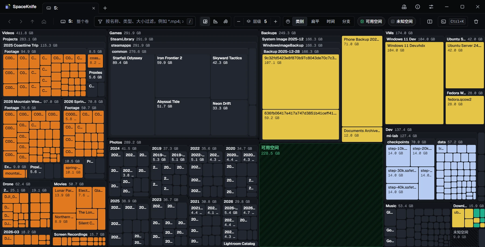
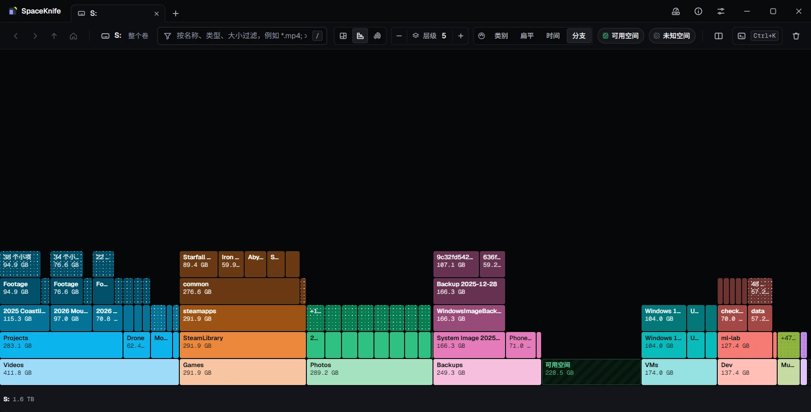
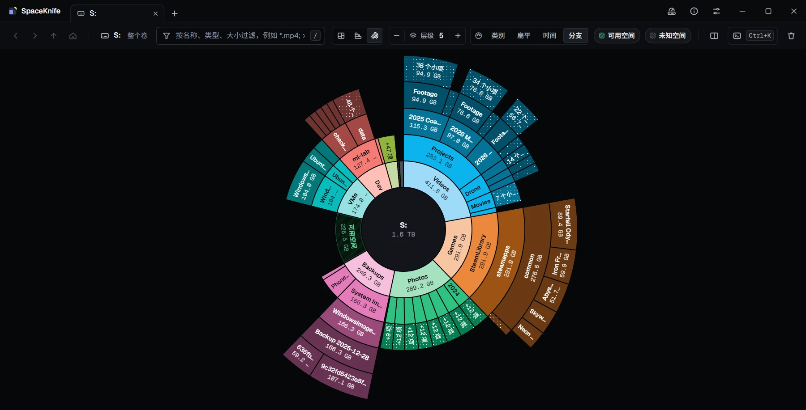

同一次扫描可以用三种方式画出来。三者显示同一份数据，共用视图的状态：缩放根、选中项、过滤和导航历史都一样。大小在树图里是面积，在火焰图里是长度，在火焰-极坐标图里是角度。哪种更能回答眼前的问题就用哪种，随时按 <kbd>V</kbd> 切换。

## 三种可视化

三种画法都从缩放根开始，一层一层画出里面的内容；区别在于一块怎样表示大小，怎样表示它在目录树里的位置：

| | 树图 | 火焰图 | 火焰-极坐标图 |
|---|---|---|---|
| 一项是 | 一个矩形 | 一段横条 | 圆环上的一个扇区 |
| 大小是 | 面积 | 长度 | 角度 |
| 一层文件夹是 | 套在父框里的一个框 | 一条横带 | 一个圆环 |
| 缩放根是 | 整个视图 | 根条 | 中心圆 |
| 适合 | 找出最大的文件 | 看空间藏得多深 | 看各部分占整体的比例 |

下面的图是同一块虚构的 2 TB 磁盘在三种可视化里的样子：细节层级 5，详情面板收起，配色是新视图的默认值（树图「类别」，两种火焰图「分支」，见[配色](#配色)）。

### 树图

树图是盒子套盒子。缩放根铺满整个视图，按里面的每一项切成一个个矩形，面积与它占用的磁盘空间成正比。文件夹的矩形是一个框，它的内容再按同样的方法切在框里，一层套一层。所以屏幕上的大小就是答案：不管藏在第几层，块越大，占的空间就越多。

- 展开的文件夹框顶部有标题栏，写着名称和大小。
- 文件是实心块，颜色是它的文件类别色（见[配色](#配色)）。
- 默认同一文件夹里大块排在左上。在「设置 › 可视化」关闭「按大小排序」后按名称排列，扫描过程中位置更稳定。
- 越深的框底色越亮一档，层级一眼能分开。「设置 › 外观」里的「层级对比」「边框对比」调节这种差别的强弱。
- 位于最后一个[细节层级](#细节层级)、或者小到放不下内容的文件夹，画成实心的折叠块，保留名称和大小。放大进入后才展开。
- 块够大时显示名称，再大一些同时显示大小，名称过长时以「…」结尾。小到没有文字的块，悬停就能看到它是什么。

「设置 › 可视化」里的「元素比例」让树图的块偏高或偏宽，0 表示尽量接近正方形。它只影响树图。

### 火焰图

火焰图把同一棵目录树切成横带，一层一条。缩放根是占满整宽的**根条**；它的子项排在下一带，每一项是一段，长度与大小成正比；每一段的子项再排在后一带，都落在这一段的范围内。顺着一摞读下去就是一条路径，同一带里的段可以直接比长短。一摞有多高，这一支就有多深：图中 Photos 和 VMs 到第三带就到底了，Videos、Games 和 Backups 一直叠到第五带，也就是细节层级。

- 默认根条在下，各层向上生长。要翻过来，把「设置 › 可视化 › 火焰图方向」改成「根在上」，已经打开的火焰图立即翻转。
- 根条显示缩放根的名称（粗体），后面紧跟大小。
- 条高 20–48 px，随「元素字号」缩放。画几带取细节层级和视图高度放得下的层数中较小的那个。
- 文件夹不论展开还是折叠都是实心条，一条很深的路径从根条往外一行就能读完。

火焰图适合又深又窄的目录树：一长串嵌套的文件夹依然清楚，同一带里的宽度也容易比较。

### 火焰-极坐标图

火焰-极坐标图是把火焰图卷成一个圆：缩放根是**中心圆**，外面每一环是一层文件夹（第 k 层是从里往外的第 k 环），扇区的角度就是它占的大小比例。

也可以把它看成一种特殊的饼图：多层堆叠，没有中心区域。

- 第一环就是缩放根的饼图：每一项一块，角度是它占的比例。
- 再往外每一环，把每个文件夹的那一块再切开，切成这个文件夹的内容，都落在这一块的角度之内。文件到这里为止，文件夹继续往外长。
- 中间不属于任何一块，空出来留给当前看的文件夹：中心圆显示它的名称和大小。

整个圆就是整个缩放根（显示可用空间和未知空间时也包括它们），所以任何一环上同样的角度都代表同样的大小；离中心越远，层级越深。图中 Games 经过 SteamLibrary、steamapps、common 一路往外，直到各个游戏；可用空间是第一环里的一个扇区。

- 从 12 点钟方向起顺时针排列，大的在前（「按大小排序」开启时）。每个扇区的角度与大小成正比，子扇区落在父扇区的角度之内。
- 中心圆显示缩放根的名称和大小。悬停某个扇区时，中心圆换成这个扇区的名称、大小和它占缩放根的比例（「占 {pct}」）。
- 环宽不小于 14 px，随「元素字号」缩放。画几环取细节层级和半径放得下的层数中较小的那个。
- 越往外的环越长，能容下更小的项，所以深处的小文件夹在外圈形成细刺。
- 标签顺着扇区的形状写：又厚又窄的扇区沿半径写名称，其他沿圆弧写，放得下时第二行是大小。文字始终是正的。
- 这里的悬停卡跟随指针，因为一个大扇区可能盖住大半个圆。

### 根条与中心圆

两种火焰图都把缩放根也画了出来，就是根条和中心圆。它对鼠标的响应：

| 操作 | 结果 |
|---|---|
| 单击 | 取消选中，详情面板显示缩放根 |
| 双击 | 上一级 |
| 右键 | 弹出缩放根的右键菜单（没有「只看这里（放大）」） |
| 悬停 | 显示缩放根的悬停卡 |
| 没有选中项时按 <kbd>Shift</kbd>+<kbd>F10</kbd> | 弹出缩放根的右键菜单 |

树图没有这样的元素：它的缩放根就是整个视图。

## 切换

| 方式 | 作用 |
|---|---|
| 工具栏「可视化」组（层级步进器左边的三个图标） | 单击选一种 |
| <kbd>V</kbd> | 下一种，循环 |
| <kbd>Shift</kbd>+<kbd>V</kbd> | 上一种 |
| 命令面板「切换可视化」 | 同 <kbd>V</kbd>，状态行显示当前是哪一种 |
| 命令面板里输入「可视化」 | 「可视化：树图」「可视化：火焰图」「可视化：火焰-极坐标图」直接选一种 |

切换时什么保持、什么不保持：

- **保持**：缩放根（包括放大进入的小项聚合块）、前进后退历史、选中项、过滤和暗化 / 隐藏方式、细节层级、可用 / 未知空间开关。
- **改变**：配色换成目标可视化上次用的那一种（见[配色](#配色)）。
- **关闭**：悬停卡和右键菜单。
- **不记入历史**：<kbd>Backspace</kbd> 不会退回上一种可视化。

新旧画面交叉淡入 200 ms；开启「减少动画」时直接切换。扫描中、暂停时、打开的快照和对比视图里都能切换，扫描本身不受影响。

当前界面画不了的可视化仍留在工具栏上，显示为禁用，提示里写着原因；<kbd>V</kbd> 会跳过它。

:::note[窄窗口]
窗口太窄、工具栏放不下时，放不下的组会收进旁边的「更多」菜单（**…**）：先把「可用空间」「未知空间」芯片缩成色块，再把「配色」组和这些芯片收进菜单，最后才收「可视化」组。按键照常可用。
:::

每个标签页、每个分屏窗格各有自己的可视化。新视图用「设置 › 外观 › 可视化 › 新视图默认可视化」。

:::tip[同一次扫描，两种看法]
打开分屏，一个窗格用树图，另一个用火焰图。树图看大文件在哪里，火焰图看它们藏得多深。见[分屏](../navigation/#分屏)。
:::

## 配色

工具栏的「配色」组有四种。按 <kbd>C</kbd> 依次切换：类别 → 扁平 → 时间 → 分支 → 类别。配色只改颜色，布局不动。

| 配色 | 工具栏 | 命令面板 | 颜色表示 |
|---|---|---|---|
| 文件类别 | 「类别」 | 「配色：文件类别」 | 按扩展名归入的文件类别：视频、图片、音频、压缩包/镜像、程序/系统、文档、游戏、代码/开发、数据/模型，其余是「其他」；游戏、项目等文件夹里的文件按文件夹归类。在「设置 › 文件类别」里修改 |
| 扁平 | 「扁平」 | 「配色：扁平」 | 不表示什么：所有文件同一种中性色，只留下大小和结构 |
| 修改时间 | 「时间」 | 「配色：修改时间」 | 文件多久以前修改过，分五档：一天内、一周内、一个月内、一年内、更早 |
| 顶层分支 | 「分支」 | 「配色：顶层分支」 | 这一块属于哪一个顶层项 |

四个「配色：…」命令只在命令面板里输入时出现；「切换配色」（<kbd>C</kbd>）一直都在。

补充说明：

- **分支**：缩放根下的每个直接子项各占一种色相（共 8 种），它下面的所有内容沿用这个色相，越深越暗。第 1 层的聚合块和可用 / 未知空间是中性灰。新分支取画面上用得最少、又和左右邻居不同的色相；扫描中块的顺序变化时，分支的颜色不变。缩放根改变后重新分配。
- **聚合块的时间和类别**：「N 个小项」块取占它字节最多的那个时间档；类别取占它至少一半字节的类别，否则是「其他」。
- **文件夹**：树图里展开的文件夹框始终用层级色，折叠块和「+N 项」块用中性的折叠色（「分支」配色下改用分支色）。火焰图和火焰-极坐标图里，文件夹段按层级用四档灰色，同样「分支」除外。

每种可视化在每个视图里各自记住配色。树图默认「类别」，火焰图和火焰-极坐标图默认「分支」。把树图换成「时间」，切到火焰图再切回来，树图仍是「时间」。新视图的默认值在「设置 › 外观」：「树图默认配色」和「火焰图和火焰-极坐标图默认配色」。

## 细节层级

细节层级决定从缩放根往下画几层。层级为 N 时，第 1 到 N − 1 层的文件夹展开，第 N 层的文件夹画成折叠块，更深的不画。

| 按键 | 工具栏 | 命令面板 |
|---|---|---|
| <kbd>Ctrl</kbd>+<kbd>=</kbd>（或 <kbd>Ctrl</kbd>+<kbd>+</kbd>） | 「层级」步进器的 + | 「提高细节层级」 |
| <kbd>Ctrl</kbd>+<kbd>-</kbd> | 「层级」步进器的 − | 「降低细节层级」 |

- 范围 1–15。新视图从「设置 › 可视化 › 初始细节层级」开始（默认 5）。
- 改层级只重画，缩放根和选中项不变。
- 每个视图有自己的层级。
- 两种火焰图只能画下放得下的带数或环数。少于要求的层数时，步进器旁显示「画得下 {n} 层」。把窗口拉高或放大进入，就能看到更多层。

:::tip
整个磁盘配上很高的层级，画面会很乱。层级保持适中，改为放大进入关心的部分：层级从缩放根算起，每放大一次都会重新多画这么多层。
:::

## 小项聚合块

小于「设置 › 可视化 › 最小元素尺寸」（3–20 px，默认 10）的项不单独画。树图按面积算，火焰图按沿横带的长度算，火焰-极坐标图按环中线处的弧长算。

太小的项会合并：

- **「N 个小项」**：同一文件夹里两个以上、各自都太小的文件。块上有点阵纹理，颜色取占它至少一半字节的文件类别，否则是「其他」。
- **「+N 项」**：这一层里仍然太小的所有东西（小文件夹、单个小文件，或本身也太小的「N 个小项」块），合并成一块中性色的块，排在最后。

对聚合块可以这样操作：

- 双击，或选中后按 <kbd>Enter</kbd>，把成员逐个铺开，大的在前；仍然放不下的又合成新的「+N 项」。面包屑末段显示「N 个小项」或「+N 项」，按 <kbd>Backspace</kbd> 返回。
- 选中后，详情面板会说明它是什么。
- 右键菜单里「打开」「在资源管理器中显示」、终端和「复制路径」不可用（聚合块不是一个具体位置），也不能加标签。「加入删除篮」把整块连同成员一起加入。<kbd>Delete</kbd> 键不加入聚合块，要用右键菜单。

调大「最小元素尺寸」，画面更清爽，块更少更大；调小则能看到更多单独的文件。

## 可用空间与未知空间

缩放根是扫描的整个卷（例如 `C:\` 或 `/`）时，第 1 层多出两块，和其他项一起排序：

- **可用空间**：系统报告的卷可用空间。绿色斜纹、实线框。
- **未知空间**：系统报告的已用空间减去扫描计入的合计，通常是扫描读不到的位置和系统保留的空间。灰色细斜纹、虚线框。差值不大于 0 时不画。扫描进行中它叫「未知空间 · 尚未扫描」，随扫描推进变小。

| 按键 | 工具栏 | 命令面板 |
|---|---|---|
| <kbd>F</kbd> | 「可用空间」芯片 | 「显示/隐藏可用空间」 |
| <kbd>U</kbd> | 「未知空间」芯片 | 「显示/隐藏未知空间」 |

- 关掉一块后其余块重新铺满，扫描到的文件就以更大的比例显示。
- 新视图按「设置 › 可视化」里的「新视图显示可用空间」「新视图显示未知空间」开始。
- 放大进入任何文件夹后这两块就消失；对比视图里、过滤选「隐藏不匹配」时也不画。它们不能放大，也不能加标签。
- 两种火焰图里它们是第 1 带（环）里的段。

未知空间很大时值得查一下：用更高的权限扫描通常能让它变小。见[故障排除](../troubleshooting/)。

## 回收站

删进回收站（macOS 上是废纸篓）的东西，在清空之前仍然占着空间。SpaceKnife 把它们标出来，免得和正在用的文件混在一起：

- 回收站里的一切都蒙上一层暗色和交叉细纹，外面围一圈珊瑚色虚线。
- 回收站本身带一个标签：「回收站 · 清空可释放 12.3 GB」（macOS 上是「废纸篓 · …」）。在火焰图里放大进回收站时，标签挂在根条或中心圆上。
- 悬停卡上写着「在回收站里：清空回收站后才释放空间」。
- 选「动态」（默认）时，虚线缓缓流动，偶尔有一道光扫过回收站；开着「减少动画」时都静止。

认得的回收站：Windows 每个盘根目录下的 `$Recycle.Bin`；macOS 的 `~/.Trash` 和卷根目录下的 `.Trashes`；Linux 的 `~/.local/share/Trash` 和盘根目录下的 `.Trash-<用户 ID>`（freedesktop.org 回收站规范，GNOME、KDE 和大多数文件管理器都用它；`rm` 直接删除，不经过回收站）。扫描整个盘时回收站在其中；只扫描某个文件夹时，回收站在里面才会出现。

SpaceKnife 实时监控扫描时，把文件移进回收站，它们的块会跟着移进去；清空回收站后，那部分空间会变成可用空间。

在「设置 › 外观 › 树图视觉 › 回收站特效」里选「动态」「静态」或「关」。

想让回收站不占画面，按 <kbd>R</kbd> 或点「未知空间」旁边的「回收站」芯片（macOS 上是「废纸篓」）。扫描里有回收站时才有这个芯片，对比视图里没有。关掉后回收站不占地方，其余的块放大填满；它的空间不会算进未知空间；已经放大进回收站的视图照常显示它。新视图按「设置 › 可视化 › 几何 › 新视图显示回收站」开始。

## 扫描中：呼吸描边

扫描时画面边扫边填，每秒更新几次。整个过程中都可以选中、悬停、放大、后退、调层级、切换可视化。

- 已经发现、还没读取的文件夹画成条纹块，写着「等待扫描…」，读完之后才展开。
- 还在读取中的文件夹（缩放根往下三层以内，以及缩放根本身）会**呼吸**：强调色的描边缓缓亮起又暗下。里层比外层稍晚一点，光像波纹一样往里传。
- 开启「减少动画」时描边保持静止。

呼吸描边和变化闪烁共用一个开关：「设置 › 可视化 › 元素变化闪烁」。

## 变化闪烁

扫描结束后，实时监控让画面跟上磁盘的变化（见[实时监控](../monitoring/)）。文件新增、删除或大小改变时，对应的块闪烁：黄色描边加光晕，闪两次后淡出。

- 变化的项没有单独画出来（太小、被合并，或在折叠块里）时，闪包含它的那一块。两种火焰图里，缩放根之内、但落不到任何条或扇区上的变化，闪根条或中心圆。
- 开启「减少动画」时不闪烁，改为在变化的块上显示静态角标，内容是变化量，比如「+212 MB」，大约十秒，放不下时不画。
- 在「设置 › 可视化 › 元素变化闪烁」关闭。

## 对比视图里

把扫描和快照对比时（见[快照与对比](../snapshots-compare/)），三种可视化都改为显示变化：

- 面积、长度或角度是变化量。文件夹的大小行是净变化，比如「+14.8 GB」「−5.7 GB」。
- 橙色是增长，分四档；蓝色是减少，分三档。分档是 1、3、8 GB，所有变化都很小时自动降到更小的单位；侧栏的图例显示当前的分档。
- 基准之后新出现的项，块够大时带「新增」角标。已删除的项按它在基准里的大小显示为减少。
- 「配色」组换成「显示的变化」：「全部」「增长」「减少」，<kbd>C</kbd> 在这三项之间切换。
- 没有可用 / 未知空间块，<kbd>F</kbd> 和 <kbd>U</kbd> 不起作用；不能分屏。
- <kbd>Esc</kbd> 先取消选中；没有选中项时再按，退出对比。

## 影响画面的设置

各项默认值、「初始细节层级」和两个「新视图显示…」只影响之后新开的视图，其余改动立即作用到已打开的视图。完整列表见[设置参考](../settings/)。

| 设置 | 位置 | 作用 |
|---|---|---|
| 新视图默认可视化 | 外观 › 可视化 | 树图、火焰图或火焰-极坐标图 |
| 树图默认配色 | 外观 › 配色样式 | 默认「文件类别」 |
| 火焰图和火焰-极坐标图默认配色 | 外观 › 可视化 | 默认「顶层分支」 |
| 减少动画 | 外观 › 动画 | 缩放和切换瞬时完成，闪烁换成角标，描边静止 |
| 层级对比、边框对比 | 外观 › 树图视觉 | 文件夹层级和块边框的明显程度 |
| 高亮光晕层数 | 外观 › 树图视觉 | 悬停或选中时点亮几层祖先（0–10） |
| 悬停高亮、选中投影、鼠标拖尾 | 外观 › 树图视觉 | 指针下的描边、选中项的投影、划过时的渐隐 |
| 元素字号 | 可视化 › 几何 | 80–140 %，条高和环宽一起缩放 |
| 最小元素尺寸 | 可视化 › 几何 | 多小的项会被合并 |
| 元素比例 | 可视化 › 几何 | 只影响树图：块偏高或偏宽 |
| 初始细节层级 | 可视化 › 几何 | 新视图的层级 |
| 新视图显示可用空间 / 未知空间 | 可视化 › 几何 | <kbd>F</kbd>、<kbd>U</kbd> 的初始状态 |
| 新视图显示回收站 | 可视化 › 几何 | <kbd>R</kbd> 的初始状态 |
| 按大小排序 | 可视化 › 几何 | 大的在前，或按名称 |
| 火焰图方向 | 可视化 › 火焰图 | 根在下或根在上 |
| 缩放动画时长 | 可视化 › 动画 | 0–600 ms，默认 250；0 表示无动画 |
| 元素变化闪烁 | 可视化 › 变化提示 | 变化闪烁和呼吸描边 |

## 本页按键

| 按键 | 作用 |
|---|---|
| <kbd>V</kbd> / <kbd>Shift</kbd>+<kbd>V</kbd> | 下一种 / 上一种可视化 |
| <kbd>C</kbd> | 下一种配色（对比视图里：下一个「显示的变化」） |
| <kbd>Ctrl</kbd>+<kbd>=</kbd> / <kbd>Ctrl</kbd>+<kbd>-</kbd> | 提高 / 降低细节层级 |
| <kbd>F</kbd> | 显示或隐藏可用空间 |
| <kbd>U</kbd> | 显示或隐藏未知空间 |
| <kbd>R</kbd> | 显示或隐藏回收站（扫描里有回收站时） |
| 双击、<kbd>Enter</kbd> | 放大进入，聚合块也一样 |

在输入框里打字时单键快捷键不生效；下拉框有焦点时，<kbd>C</kbd> 和 <kbd>V</kbd> 留给下拉框。macOS 上凡是写 <kbd>Ctrl</kbd> 的地方都可以按 <kbd>⌘</kbd>。全部按键见[快捷键](../shortcuts/)；放大和其他导航操作见[浏览与导航](../navigation/)。
